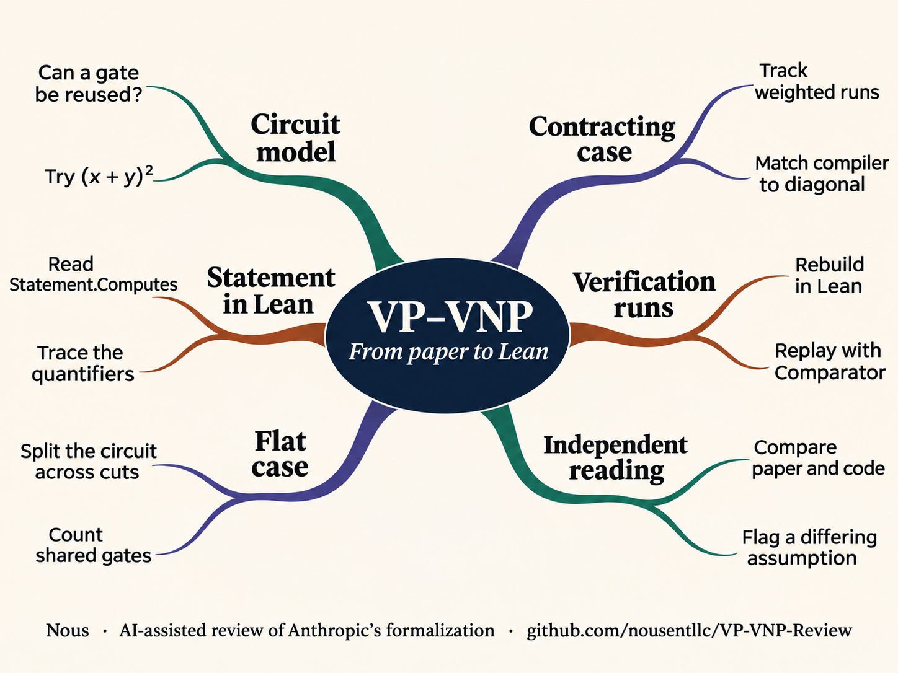

# VP–VNP research review

This repository is a human–AI reading companion to Anthropic’s *VP ≠ VNP Over Every Field*. The theorem and its Lean formalization are the publisher’s work. We reconstruct the path from the paper’s claims through definitions, lemmas and proof dependencies, then turn that path into questions a person can check. The verification runs record which formal declarations and proofs the software accepted.

## Why read this review?

A formal proof checks a precisely stated proposition. A person still has to ask whether that proposition captures the intended claim and whether each change of model or resource bound means what the paper says it means. Our investigation makes those questions small enough to retrace by hand. For each selected claim, we locate the paper and Lean source, work through the mathematical step, and record what a computation or verification run establishes. You can challenge one step without first accepting our assessment of the whole proof. [Statement correspondence](passes/statement-correspondence.md) · [Claim register](report/proof-coverage.csv)

**Try one question in five minutes.** Draw `(x + y)²` using one addition gate. Can both inputs to the multiplication gate refer back to that same sum? Read §1.3 of the paper, then inspect the indices `i` and `j` in `Statement.Computes`. The definition permits `i = j`, so this particular circuit can reuse the sum. Next ask whether that matches the circuit model you took the paper to claim. [Paper, §1.3](primary/vp-vnp/paper.pdf#page=3) · [Lean definition, lines 20–27](primary/vp-vnp/Statement.lean#L20-L27) · [Circuit investigation](passes/01-claim-and-circuits.md)

**Go further at your own depth.** Read the [whole-chain walkthrough](passes/14e-circuit-to-contradiction.md) to follow one hypothetical small circuit through either branch of the field alternative. Use the [claim register](report/proof-coverage.csv) to choose a lemma or an open reading question. If you work with Lean, the [reproduction guide](REPRODUCE.md) provides the pinned sources, commands and expected evidence. A fresh run and an independent reading of what the declarations mean are two distinct contributions.

If a definition, quantifier or proof step reads differently to you, please show the smallest example or source location that exposes the difference. An independent review of the paper-to-Lean statement correspondence is especially valuable. [Human-review invitation](https://github.com/nousentllc/VP-VNP-Review/issues/1)

## Edition 12 findings and evidence

The review team’s Linux verification run accepted the five public declarations in Lean and nanoda. The statement audit traces the printed circuit and witness models into the formalization. The errata identify two passages in the printed account that warrant narrower wording. Reproduction by an outside operator is pending for the release candidate. [Evidence and attribution](reconciliation/release-candidate.md)

1. [Two-page verdict](report/verdict/VP_VNP_Verdict.pdf)
2. [Whole-chain companion](passes/14e-circuit-to-contradiction.md)
3. [Publisher errata](passes/publisher-errata.md) · [K.3 and I.1 submitted upstream in #57](https://github.com/anthropics/formal-math/issues/57)
4. [66-page technical report](report/VP_VNP_Research_Review.pdf)
5. [Claim register](report/proof-coverage.csv)

**Independent human statement-level sign-off is pending.** The [statement audit](passes/statement-correspondence.md) records the AI-assisted reading of the exact and border models. An algebraic complexity theorist is invited to compare the printed claims with the pinned Lean statements. [Human-review invitation #1](https://github.com/nousentllc/VP-VNP-Review/issues/1). The [editable TeX master](report/VP_VNP_Research_Review.tex) and [Chat handoff](VP_VNP_Chat_Handoff.md) preserve the full derivations. The [external-review response](reconciliation/edition12-external-review.md) identifies the AI critique and its scope.

## Follow-up

Lean 4.33.1 verified tighter J.4 bounds for the cutter’s accepting time, piece count and piece size under the published hypotheses. The follow-up also checks the effect on two terms in K.5’s existing cost calculation. [Technical note, Lean source and receipt](followups/j4/README.md).

## Reproduction and licensing

[Reproduce Edition 12](REPRODUCE.md) from the full tagged repository. It has one command per tier and expected evidence hashes. The [preserved Actions artifact and complete job log](history/actions/README.md) accompany the release. Review code and checks use the [MIT License](LICENSE). The original report and written investigations use [CC BY 4.0](LICENSES/CC-BY-4.0.txt). The publisher’s `primary/vp-vnp/` subtree stays under its own [Apache-2.0 license](primary/vp-vnp/LICENSE) and [notice](primary/vp-vnp/NOTICE). [Full license scope](LICENSES/README.md).

## A reader's route through the argument

1. Fix a field, a matrix size and a hypothetical circuit. Earlier gates may be reused, constants may depend on the field and size, and cancellations are allowed. M.1 specializes all coefficients together to a comparison field. Read the HC and permanent projections to see why their characteristic restrictions differ. [Model](primary/vp-vnp/Statement.lean#L23) · [Theorem 1.1](primary/vp-vnp/paper.pdf#page=2) · [HC](passes/12b-hamiltonian-projection.md) · [Permanent](passes/pass13C-permanent.md)
2. In the flat branch, E.4 charges each reused gate once per balanced subset. E.7 permits differently cut summands. E.8–E.9 supply one spectral witness for all possible paying cuts. E.10 states log₂L≥ℓk√k/16. Its printed proof and Lean arithmetic already give denominator 14. The review’s strict denominator 12 is a minor local tightening. E.11 converts the auxiliary scale into a bound for every sufficiently large target size. [Shared gates](passes/pass13A-gate-reuse.md) · [Price and circuit estimates](passes/14a-flat.md)
3. In the contracting branch, H.1 constructs the tower and H.2 applies the G.2 identities, routes packets, preserves weighted values and accounts for resources. K.2 and K.3 take any small circuit and produce a bounded weighted evaluator for short plain instances. The concrete formal word polynomial can differ from the printed one away from its legal inputs. K.2 compiles an exact circuit for the clause polynomial. K.3 uses its degree bound and then invokes their common evaluations on canonical inputs. [Tower and laws](passes/14b-tower.md) · [Circuit compiler](passes/14c-compiler.md)
4. Follow the exact matching of field, size, scale and program in K.3 and K.6. The diagonal yields V=1+V in a nonzero ring. The separate membership witness places HC in VNP, and the exact lower bound excludes it from VP. [Arbitrary circuit to contradiction](passes/14e-circuit-to-contradiction.md) · [Rooted HC witness](passes/pass13D-membership.md)
5. Compare that mathematical reconstruction with the [complete-release verification record](passes/14d-formal.md) and the [coverage register](report/proof-coverage.csv). The native Lean rebuild compiled all 324 publisher sources, including the complete exact and approximate endpoints. The Linux run launched by the review team accepted all five public declarations with nanoda enabled. The proof-term checks and the remaining manuscript/implementation correspondence have distinct scopes. Reusable ideas are recorded in the [transferable-mechanism register](report/transferable-mechanisms.md).

## Verification runs and recorded evidence

The [check catalogue](checks/README.md) lists the individual controls and archived receipt modes. The [report build receipt](report/edition12-build.json) pins the TeX inputs and published PDF digest. The [Edition 12 handoff](VP_VNP_Chat_Handoff.md) records the K.4–K.6 derivation, the targeted 16-module build and its verification boundaries.

## Reproduce Edition 11

The [source lock](source-lock.json) identifies the publisher commit, 11b6c7e3c927df2658f513b6b68ea7f8929c62c5, original PDF and locked libraries. First run `python3 checks/pass14_reader_check.py` to verify the complete package offline. Run the three finite controls individually from the repository root with Python 3.9+ and its standard library. Each script emits deterministic JSON that can be compared with the corresponding checked-in result.

~~~sh
python3 checks/pass14a_flat.py
python3 checks/pass14b_tower.py
python3 checks/pass14c_compiler.py
~~~

For a fresh build of the entire original Lean project, install Lean 4.33.1 and prepare a built mathlib checkout and dependencies at the revisions in the [Lake manifest](primary/vp-vnp/lake-manifest.json). Set MATHLIB_DIR to its path. The runner checks all package revisions, builds from source into a previously absent directory, compares challenge and solution signatures in separate environments, and queries the permitted axiom dependencies. Pass the objects subdirectory shown below to check the review's separate /12 circuit theorem. The complete local-project build uses prebuilt external packages. [Release runner](checks/pass14_release.py) · [Independent arithmetic and circuit bridge](checks/pass14a_margin_replay.py)

~~~sh
python3 checks/pass14_release.py --mathlib "$MATHLIB_DIR" --jobs 3 --work-dir /tmp/vp-vnp-pass14-fresh --output /tmp/pass14-release.json
python3 checks/pass14a_margin_replay.py --mathlib "$MATHLIB_DIR" --objects /tmp/vp-vnp-pass14-fresh/objects --output /tmp/pass14-margin.json
~~~

The [original Linux build and Comparator logs](checks/pass14_linux_artifact.zip) are preserved with their GitHub artifact digest. For the hosted verification use the [pinned-project workflow](.github/workflows/pass14-comparator.yml). It checks the project and driver against their original Git objects, builds the default Lake targets on a disposable Linux runner and invokes the publisher's Comparator with the locked five-theorem configuration. The review team’s [Linux run 45691617731](https://github.com/nousentllc/VP-VNP-Review/actions/runs/45691617731) completed the unmodified driver and returned its exact acceptance marker. [Machine receipt](checks/pass14_comparator.json). The [formal track](passes/14d-formal.md) records which stages ran, their actual outcomes and evidence retention. The [publisher configuration](primary/vp-vnp/comparator.json) lists the five names, three permitted axioms and Nanoda setting.

Edition 11's original TeX, PDF, [build receipt](report/edition11-build.json) and complete source tree remain in the archived packet below. Extract that packet before rebuilding the historical PDF. Each edition has one editable TeX master, included fragments and the original Nous PNG directly below the cover subtitle.

## Review packets

[Read the current Edition 12 handoff](VP_VNP_Chat_Handoff.md) for the public correspondence and sign-off status.

[Download the original Edition 12 research packet](handoff/VP_VNP_Review_2026-11-25_pass15.zip). Its 509 files reproduce the research snapshot at `3d3d24a8d43836a6df80bc87bf483745aa66dc54`. Every member matched its Git blob. A clean extraction passed the full offline suite and rebuilt both the two-page verdict and 66-page technical report byte for byte. ZIP SHA-256 `b9c8124b1947998a78ddf2e7893d94392bba035ddd75bca76fc7babfdfda122b`. The packet includes the pinned publisher source, editable report and all receipts. Earlier handoff ZIPs are available separately below.

[Browse the nine archived investigation packets, numbered 6–14](history/handoffs/README.md). Their archive bytes and original Git history are preserved.

## Earlier mathematical and formal records

- [Paper](primary/vp-vnp/paper.pdf) and [formal source](primary/vp-vnp/) from Claude (Anthropic). The `primary/` directory preserves the publisher’s files for offline reading. Its [license](primary/vp-vnp/LICENSE) and [attribution](primary/vp-vnp/NOTICE) accompany the source.
- [Source manifest](source-lock.json) identifying the exact publisher commit and the PDF’s SHA-256 digest. A checkout includes the same paper and proof files that the review cites.
- [Small algebra checks](checks/check_bounds.py), [recorded results](checks/results.json), and [publisher CI evidence](checks/upstream-ci.json). Run `python3 checks/check_bounds.py` to reproduce the algebra checks. The universal automaton investigation asks how many accepting runs the simulation preserves and how long they take. The [run-multiplicity checks](checks/pass05_traces.py), [source-language examples](checks/pass05_examples.lean) and [time-bound lemmas](checks/pass05_time.lean) accompany the [investigation record](passes/05-universal-automaton.md), which gives their execution conditions and the scope of the independent Lean checks.
- [One-cut and iteration review](passes/06-one-cut-and-iteration.md) and [finite checks of weights and resource bounds](checks/pass06_cuts.py). Run `python3 checks/pass06_cuts.py` from this directory.
- [Theorem D.2 and field coverage](passes/07-field-alternative.md), with [exact finite checks](checks/pass07_geometry.py) and [reflection lemmas](checks/pass07_reflection.lean). Run `python3 checks/pass07_geometry.py` from this directory.
- [Proposition C.3 and price-space completion](passes/08-price-space-completion.md), with [exact midpoint examples](checks/pass08_midpoints.py) and [a local replay of the publisher’s two completion lemmas](checks/pass08_completion.py).
- [Theorem C.1, the curvature bound and its limits](passes/09-curvature-bound.md), with [finite-box boundary checks](checks/pass09_fan_boundary.py), [endpoint lemmas](checks/pass09_endpoint.lean), and the [full publisher-source replay](checks/pass09_endpoint_replay_results.json). The [portable replay script](checks/pass09_endpoint_replay.py) gives the toolchain and input requirements. Run `python3 checks/pass09_fan_boundary.py` from this directory.
- [Propositions A.7 and A.8, simultaneous extension](passes/10-simultaneous-extension.md), with [exact examples](checks/pass10_examples.py) and [formal statement and axiom queries](checks/pass10_formal.lean). The [24-module verification record](checks/pass10_formal_results.json) and [portable runner](checks/pass10_formal_replay.py) document the local replay. Run `python3 checks/pass10_examples.py` from this directory.

- The investigations of geometry and field transfer cover [crossing and curvature](passes/11a-crossing.md), [spectral selection](passes/11b-spectral-selection.md), [weighted piece decomposition](passes/11c-piece-decomposition.md), and [field transfer](passes/11d-field-transfer.md). Each record distinguishes general arguments, finite controls and machine-check scope.

- The branch estimates and projections cover [contracting laws and stage load](passes/12a-contracting-laws.md), [the Hamiltonian-cycle projection](passes/12b-hamiltonian-projection.md), [the growing-dimension flat estimate](passes/12c-flat-estimate.md), and [crossing counts and signs](passes/12d-counting-and-minors.md). Each note links its original-source locations, reproducible checks and the specific evidence from Lean.

- A [combined Lean verification run](passes/pass13E-branch-replay.md) accompanies the investigations of gate reuse, gain, the permanent and Hamiltonian-cycle membership. The complete section-by-section derivations and worked examples appear on pages 19–30 of the PDF.

## Reading the technical appendix

The [Edition 12 handoff](VP_VNP_Chat_Handoff.md) records J.3–J.4 as an optional topic for readers studying how the cutter is implemented. K.5 uses the same cut to control encoding, list lengths and accepting times, then uses piece plainness to replace weighted values. The exact and approximation claims retain distinct hypotheses. RCMG and QFTN / Uriel-GEMA remain independent projects.

## TeX covers

Use the [original Nous PNG](report/nous-black.png) on the front page directly beneath the title and subtitle of each new or revised research TeX document.
