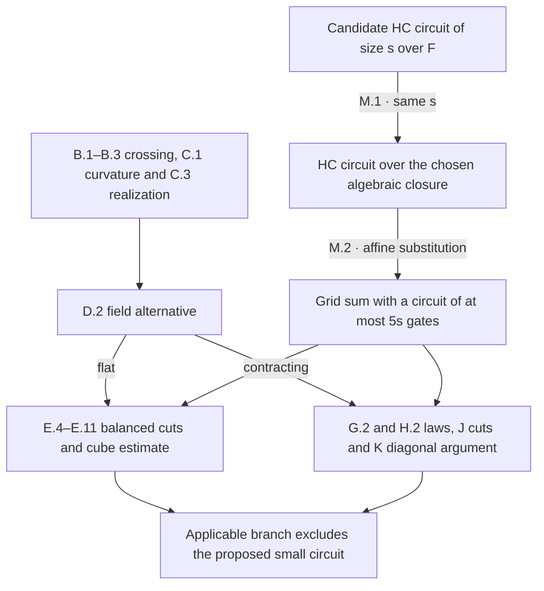

# VP–VNP paper review · Cumulative findings for Chat

**Edition 10 · November 25, 2026 · Thirteen passes.** This is an independent audit of the pinned release of Claude (Anthropic), *VP ≠ VNP Over Every Field*. The exact-circuit claim is under review. The internal QFTN / Uriel-GEMA catalogue supplies no premise of the proof.

**What changed.** An arbitrary reused gate is now traced through E.4 to the precise tensor representation consumed by the flat branch. G.2’s choice of degree and integer load menu is compatible with the promised stage gain. The permanent gadget needs a factor of one half at every incidence, while the Hamiltonian-cycle family has a rooted Boolean witness over every field. These findings answer distinct questions about the two branches and membership. The full chain from a proposed small circuit to a contradiction in each branch remains under audit. [Graduate-level report](report/VP_VNP_Research_Review.pdf) · [Editable TeX](report/VP_VNP_Research_Review.tex) · [Coverage map](report/proof-coverage.csv)

## The claim a future reader should start with

For each m, use the m² variables of a generic m-by-m matrix X. Both target polynomials have degree m. The permanent sums the edge-weight product over all permutations, while the Hamiltonian cycle polynomial HC sums over permutations consisting of one cycle through all m vertices. A circuit is a finite list of variable, field-constant, binary-addition or binary-multiplication gates. Earlier gates may be reused. Size counts the inputs and constants. The output must equal the target as a formal polynomial. The circuit may depend on m, use arbitrary field constants and exploit cancellation.

Theorem 1.1 claims an absolute c>0 such that for every characteristic p there is an m₀(p) for which **every** field of characteristic p, **every** m≥m₀(p), and **every** circuit for HCₘ satisfy

\[
\mathrm{size}>m^{\,c(\log_2 m)^{1/3}}=2^{\,c(\log_2 m)^{4/3}}.
\]

The claim also covers PERMₘ when p≠2. In characteristic two the permanent coincides with the determinant. HC belongs to VNP in every characteristic, so the bound would put VP strictly inside VNP over every field. Theorem 1.4 treats approximating circuits separately. This review covers the exact-circuit result. Boolean P versus NP is a separate question. [Manuscript, pp. 1–4 and 60–62](primary/vp-vnp/paper.pdf#page=2) · [Pinned formal statement](https://github.com/anthropics/formal-math/blob/11b6c7e3c927df2658f513b6b68ea7f8929c62c5/vp-vnp/Statement.lean#L23-L46)

## How the four audits meet at an arbitrary circuit

Read the diagram as an attempted counterexample to the bound. M.1 first moves the candidate to a comparison field. For each grid instance within the size budget, M.2 converts the HC circuit into a circuit for that instance over the comparison field. Each branch chooses the grid it needs. D.2 then makes at least one branch available there. The permanent uses its own projection with an additional field hypothesis.

The flat proof may select different balanced cuts for different summands. The contracting proof first represents circuit evaluation as a sum of weighted runs. The universal-circuit obligation is to justify those transformations for the original gate model. [Circuit model](passes/01-claim-and-circuits.md) · [Flat rate](passes/12c-flat-estimate.md) · [Contracting branch](passes/03-contracting-branch.md) · [HC projection](passes/12b-hamiltonian-projection.md)

## What changed over the thirteen passes

| Finding | Evidence and implication |
|---|---|
| **1. The general-circuit argument has two branches.** | D.2 says at least one of two geometric hypotheses holds for a field. In the flat case E.4 decomposes the output of an arbitrary circuit. In the contracting case K.2 expands its gates by homogeneous degree. M.1–M.4 handle fields and the Hamiltonian-cycle substitution. We checked how these statements connect. Pass 7 reconstructs coverage conditional on the upstream price geometry. [Opening record](passes/01-claim-and-circuits.md) |
| **2. The flat branch pays for the freedom to use different cuts.** | E.4 allows up to L products *per balanced subset*, for an L-gate circuit of the auxiliary polynomial. A three-block example in the pass record shows why picking one cut for the whole tensor would fail. E.7 bounds the cost of adding the differently cut pieces. E.9 provides one spectral point that works for all candidate cuts simultaneously. Independently simplifying equation (E.2) on p. 37 gives log₂ L ≥ ℓk^(3/2)/14, enough for E.10’s stated denominator 16. This is conditional on the cited spectral and geometric lemmas. [Flat-branch derivation and counterexample](passes/02-flat-branch.md) |
| **3. The contracting branch uses a narrower notion of fast evaluation than a Boolean algorithm.** | K.2’s evaluator may use named circuit-dependent field constants, and its output is the sum of weights of accepting runs. Time is bounded per accepting run. We checked shared-gate multiplicity, cancellation in characteristic two, the exponent arithmetic for one K.5 scale change, and the order of halting and value guarantees at the K.6 diagonal. The formal caller supplies the cutting hypothesis needed by K.6. Pass 5 examines I.1’s evaluator and time bound. Pass 6 traces the construction, composition and budget at their stated interfaces. The underlying tower laws and the full machine implementation still have independent proof obligations. [Weighted-program review](passes/03-contracting-branch.md) |
| **4. The bounded outcome sum suffices at the J.2 → J.3 interface.** | Appendix Q, p. 69 flags a difference between the prose and the formal finite range. We followed the actual consumer. The source equates the input network value to a bounded sum, bounds counts generated by the moves, regroups that sum into pieces and uses precisely that equality in J.3. This resolves the specific concern about dropping a needed contribution at that call. The equivalence between the prose machine model and its full encoding still requires independent review. [Formal correspondence and exact source locations](passes/04-formal-correspondence.md) |
| **5. I.1 preserves the value and exact-time bound. Its implementation can discard a zero-weight accepting branch.** | The source expression that weights an unsupported name accepts once at cost two. The constructed pointer interpreter gets stuck on its first unsupported bit. Both contributions are zero. Valid accepting pointer traces then have unique matched encodings, while the final matrices preserve the sum over those encodings. The proof accounts for the two tape sides, input length and trailing idles at each sufficiently large t. K.3 chooses a single such t for every short plain input at a scale. [Counterexample, time derivation and caller audit](passes/05-universal-automaton.md) |
| **6. J.3 and J.4 preserve the weighted value, and iteration pays for building the piece lists.** | J.3 supplies one program for every short input at a fixed parameter tuple. All cutter runs halt. The time limit covers accepting runs. For plain inputs the finite sum composes by distributivity. The dealer omits an absent-packet assignment at an active wire only where a group factor is zero. J.4 handles equality at the scale switch and pays the time for processing and concatenating every piece. We independently derived the rounding and final margins and ran 15 finite resource cases. [One cut and iteration](passes/06-one-cut-and-iteration.md) |
| **7. D.2 covers every field under the stated price geometry.** | One compactness argument yields simultaneous rank averages on each fixed matrix space. Nonnegative defects convert those equalities into pointwise constraints. Rank-one exchange and reflection fix every distance. C.4(f) extends the diagonal cube to all its points. A metric with the same rank means violates the required four-point inequality by 1/8. Pass 8 reconstructs the CAT(0) price-space realization conditional on A.8 and C.1. [Eight-step reconstruction and checks](passes/07-field-alternative.md) |
| **8. Completion preserves the original price and the midpoint inequality.** | A.8 provides upper bounds from one shared coin and preserves all old distances. Replacing its output with the raw expectation gives a four-point metric that fails curvature. C.3 keeps one midpoint fixed for every test point, and one approximating map controls every pair of a finite configuration over the same field. The publisher’s two completion lemmas replayed locally. [Derivation, counterexamples and Lean replay](passes/08-price-space-completion.md) |
| **9. The curvature error vanishes in the required order.** | On each fixed fan average the squared-length telescope exposes the original midpoint defect. Its finite-box boundary error is at most $D(D+b)S(S-1)/n^2$ at fixed step $S$. After taking the mean, the estimate holds for every $S$. The parallelogram inequality gives a concave sequence whose slope removes the comparison length $A$ at fixed $T$. Dividing by $1/T$ leaves a uniform bound depending only on the original four points. The proof allows the averaged seminorm to change with $T$. The publisher’s C.1 module and dependencies replayed locally. [Constants, quantifiers and boundary stress test](passes/09-curvature-bound.md) |
| **10. A single extension preserves every old distance and bounds all the new pairs.** | A.7 selects a dominated spectral point that is exact on one tensor. Saturating the unit can still collapse the binary-wire distance from 1 to 0. The product of all old wires makes every nonnegative old-distance deficit vanish. On finite tables the extension of each approximation costs at most one approximation error per pair. On arbitrary sets a single limit over finite supersets makes the local tables agree on overlaps. New-pair bounds use a joint law and can be strict. [A.7–A.8, source references and counterexamples](passes/10-simultaneous-extension.md) |
| **11. Four links in the general-circuit argument.** | B.2–B.3 use one coefficient across both cuts. A.5 supplies one point retaining every multiplier-stable comparison. J.2 pastes assignments uniquely and charges each piece's nonexceptional boundary to one node. M.1 specializes the complete finite set of circuit constants at once and keeps the gate count. Details and evidence follow below. |
| **12. The target reduction, two quantitative estimates, and the crossing identity.** | M.2 preserves each assignment's weight and gives a circuit substitution cost at most five times the original size. E.9's error accumulates by level, H.2 bounds a corrected load, and B.1–B.2 give compatible counts and signed factorizations for both cuts. The new audit records below state the fields, witnesses and machine-check scope. |
| **13. The flat decomposition covers arbitrary gate reuse. G.2 has the right uniformity. E.1 and the HC witness have different characteristic requirements.** | One cofactor per original gate and balanced subset records repeated uses and cancellations. A uniform Poincaré constant lets G.2 select the degree before the rounded tables and label width. The permanent gadget pairs identical contributions; a fixed start makes the HC witness count each cycle once. [Gate audit](passes/pass13A-gate-reuse.md) · [Gain](passes/pass13B-gain.md) · [Permanent](passes/pass13C-permanent.md) · [HC witness](passes/pass13D-membership.md) |

## Pass 11 across both branches

| Track | What the independent audit adds | What still depends on the paper |
|---|---|---|
| **A. Crossing and curvature** | B.2 gives two decompositions of each coefficient tensor. B.3 selects one coefficient by its spectral value before bounding either cut. Complementary indices share a squared-size budget. The counting error is uniform over the index. C.2 averages the resulting scalar inequality. In an exact 16-entry example a middle coefficient has both cut ranks four over the rationals and vanishes modulo two. | The general counting asymptotic, determinant minor identities and tensor routing enter as inputs. The Manhattan example refutes the shortcut that chooses a different witness per cut. [Calculations, source lines and controls](passes/11a-crossing.md) |
| **B. Spectral selection and the flat branch** | A.5 retains all comparisons that hold after every multiplier. A directed lower bound and Zorn's lemma select a minimal constrained gauge. Its growth radius and localization force multiplicativity. In E.8, equality on a positive product preserves the old wire distances and the moved unit exponent together. E.9 reuses the base spectral point and scale throughout its cube induction. | The choice is existential. E.9 also needs the flat-field Euclidean realization. The complete quantitative passage through mixed cuts and the growing cube has further review work. [Proof, two weakened hypotheses and queries](passes/11b-spectral-selection.md) |
| **C. Piece weights and resource bounds** | J.2 uses a shared value per current crossing packet ID. Parallel packets have distinct IDs. Copies of a consumed packet have no current equality constraint. Pasting assignments is unique. A test with cancellation gives weighted value 1 before and after grouping, 0 when parallel IDs are merged, and 8 with independent boundary guesses. For the resource bound, every nonexceptional boundary packet of one heavy/light piece meets one common node. | The charge uses H.2's thin-tree incidence and exceptional-packet estimates. The original candidate circuit can have arbitrary wiring. A complete replay of J.2/J.3 and a mathematical audit of the laws producing H.2 remain open. [Partition, budgets, caller and controls](passes/11c-piece-decomposition.md) |
| **D. Field transfer and quantifiers** | For a fixed circuit, M.1 specializes the finite algebra containing all its constants into an algebraically closed field of the same characteristic. All gate relations, the chosen output and the exact gate count survive. An element satisfying $a^2+a+1=0$ in the four-element field cannot be specialized into its two-element prime field. M.3 fixes $c=1/1600^2$ before the characteristic, and its threshold before the field and circuit. | M.3 uses the lower bounds on a chosen algebraic closure and M.2’s Hamiltonian-cycle projection. The rate comparison is asymptotic for each fixed characteristic. M.4 also needs the HC membership witness. [Descent, threshold and evidence](passes/11d-field-transfer.md) |

## What pass 12 adds

| Proof interface | Finding and consequence | Remaining dependency |
|---|---|---|
| **G.1/H.2 → J.2, weighted law move** | A common law index at each bit layer, the variable-length payload, and a trailing delimiter make the packet assignment decodable. In a signed exact check, deleting the index labels or the last packet changed a forbidden input pair's value from 0 to 1. The recurrence halves the live load **plus a vertex-count correction**. Last packets remain part of the value even when charged separately to the exceptional budget. | The stage proof assumes the tower and laws of sufficient gain. A.6, F.6 and the construction in G.2 supply inputs that merit independent end-to-end audit. [Law, stage estimate and bounded caller](passes/12a-contracting-laws.md) |
| **M.2 → HC circuit bound** | Every pair of shared bit assignments chooses one Hamiltonian cycle of the constructed graph, of the same weight. Unused edges contribute zero to the polynomial. Forced padding changes the vertex count without adding choices. An HC circuit of size $s$ produces a grid circuit of at most $5s$ after affine substitution. M.1 field descent, by comparison, preserves size exactly. | HC membership in VNP (M.4) and the characteristic-dependent permanent construction (E.1) are separate. [Two bijections, exact checks and fresh module replay](passes/12b-hamiltonian-projection.md) |
| **E.7–E.11, flat rate** | The tensor power goes to infinity at fixed cut alphabet. Then at a given dimension $k$, one base point and scale cover every candidate hub. Midpoint errors average over children and accumulate at most once per level. The outer tolerance $1/(1000k)$ keeps the hub saving large enough to force a circuit bound. At $k=64$, replacing it by a fixed $1/1000$ lets the displayed estimate admit $\log_2 L=0$. | The result assumes flatness and the balanced decomposition of the arbitrary circuit. Full implementation-level review of E.4 and the complete rate module remains open. [Parameter schedule, mixed cuts and threshold](passes/12c-flat-estimate.md) |
| **B.1–B.2 → B.3, crossing counts** | Reversing the residues in half of a Frobenius symbol gives exact energy scaling. The same positive growth coefficient works at both ends of the crossing estimate. An independent calculation gives $\kappa=\pi/\sqrt3$. In the manuscript's ordered Schur expansion, the exterior signs cancel for every pair of equal-sized minors. Lower and complementary degrees then each factor across the required cut. | The value of $\kappa$ is an additional mathematical derivation. The fresh formal B.1/B.2 run covers the publisher's existential constant and integral identities. A.3’s routing maps also survive coincident physical sites when distinct logical indices are retained. E.10 uses an additional logical separation at its caller. [Routing and collision controls](passes/12d-hub-routing.md) [Counting, signs and controls](passes/12d-counting-and-minors.md) |

## What the verification record supports

The local 70-page manuscript is byte-for-byte identical to the PDF in Anthropic’s November 23 release commit. The packet includes the complete 333-file paper subtree, its license and notice, and the relevant repository-level CI workflow and checking script. Each upstream file was checked against its Git blob ID. The paper’s SHA-256 is `882f5eefb1e067cc8c99ddfe660c10d1d67f9fcee7b69364bd0bab06c0c1f97c`. [Source manifest](source-lock.json) · [Pinned publisher release](https://github.com/anthropics/formal-math/tree/11b6c7e3c927df2658f513b6b68ea7f8929c62c5/vp-vnp)

GitHub’s job record for that commit shows successful build and Comparator steps for this project. We inspected the recorded results, the selected proof-source calls, and the publisher’s check configuration. We ran the accompanying algebra and pointer-trace checks. In pass 5, Lean 4.33.1 checked focused source-language examples and two general arithmetic lemmas. In pass 7 the pinned Lean toolchain also checked two focused real-valued reflection lemmas. Pass 8 replayed the unchanged C.3 Cauchy and dense-set completion lemmas locally with the pinned Lean toolchain. Pass 12E subsequently rebuilt the full C.3 and D.2 modules from source. Independent replay of the entire Proposition I.1 module, the full separation build and Comparator remains open. The pass record gives the local import conditions and rebuild limits. The paper assigns several program-exactness and resource arguments to the formal development on p. 17. A machine check and a mathematical review of whether its definitions encode the intended objects answer different questions. [Publisher job](https://github.com/anthropics/formal-math/actions/runs/45272623486/job/138036167794) · [Saved job metadata](checks/upstream-ci.json) · [Local check results](checks/results.json) · [Reproduce the algebra checks](checks/check_bounds.py) · [Pass 5 trace results](checks/pass05_results.json)

Pass 9 independently checked the finite-box boundary identity and its growing-step failure of uniformity with exact rational arithmetic. Pinned Lean 4.33.1 checked the publisher’s discrete concavity lemma and four review lemmas, including a proof of the two limits with the fan bounds as hypotheses. A separate local run then compiled all 44 unmodified project modules needed by C.1 using the pinned external libraries. A fresh import confirmed the theorem type and reported only `propext`, `Classical.choice`, and `Quot.sound` for C.2, the endpoint estimate and C.1. [Pass 9 evidence](passes/09-curvature-bound.md) · [Finite-box check](checks/pass09_fan_boundary.py) · [Focused endpoint check](checks/pass09_endpoint_results.json) · [Full C.1 replay and theorem readback](checks/pass09_endpoint_replay_results.json)

For pass 10, Lean 4.33.1 rebuilt the 24 original publisher modules needed for `Paper.Prices`, using the pinned external libraries. Their source bytes matched the pinned Git tree. Type and axiom queries on 13 declarations confirmed the placement of the existential witnesses and universal bounds; each axiom list contained only `propext`, `Classical.choice` and `Quot.sound`. Independent finite examples tested unit saturation, shared probability and the loss of consistency under separate coordinate limits. [Pass 10 formal results](checks/pass10_formal_results.json) · [Exact finite checks](checks/pass10_examples.py)

Pass 11A checked the two cut ranks and the integral coefficient identities on a finite example using exact arithmetic. Pass 11B checked 11 publisher declarations against verified pass-10 objects, and Lean checked four new declarations exposing the need for directedness and the multiplier quantifier. Pass 11C rebuilt the two modules for packet regrouping and the four modules for heavy/light pieces, with five declaration readbacks. The larger J.2/J.3 modules remain open. Pass 11D rebuilt all 12 M.1 modules. It checked three publisher declarations and the two-element-field obstruction. M.3 was reconstructed from source. All nine finite-control scripts from passes 1–11 also ran successfully in this edition. The four notes above specify the assumptions and the first remaining obligations. [Crossing check](checks/pass11a_crossing.py) · [Spectral selection receipt](checks/pass11b_selection.json) · [Grouping receipt](checks/pass11c_groups_replay.json) · [Partition receipt](checks/pass11c_heavy_replay.json) · [Field transfer receipt](checks/pass11d_transfer_results.json)

Pass 12 rebuilt two publisher modules for the contracting stage estimate, 13 for M.2 and ten for B.1/B.2. The law gluing and five flat-rate arithmetic declarations were checked as isolated publisher-source excerpts. New review checks cover signed packet decoding, actual graph cycles, the midpoint-error induction, type selectors, energy counts and signed minors. [Stage receipt](checks/pass12a_stage_results.json) · [Law excerpt receipt](checks/pass12a_law_results.json) · [M.2 receipt](checks/pass12b_projection_replay.json) · [Flat-rate receipt](checks/pass12c_replay_results.json) · [Crossing receipt](checks/pass12d_formal_results.json)

**12E · Formal field coverage.** In addition to the four mathematical audits, Lean rebuilt all 54 original project modules ending at D.2, including C.1 and C.3, in a clean object directory against the pinned libraries. D.2 supplies a disjunction. For each characteristic M.3 applies it to a chosen algebraic closure, then uses M.1 to transfer the size bound to arbitrary fields. This closes a replay obligation from passes 7–9. The two circuit lower bounds, model correspondence and whole-project Comparator retain their own obligations. All 14 finite-control scripts across editions also ran successfully. [Field-alternative audit](passes/12e-field-alternative-replay.md) · [Replay output](checks/pass12e_alternative_replay.json) · [Verify the archived source and receipt](checks/pass12e_verify_pin.py)

## Pass 13 · Four proof steps a reader can reproduce

| Question | Derivation and test | Consequence and boundary |
|---|---|---|
| How can E.4 charge each gate only once per cut? | Induct on the original gate index, collect coefficients by gate and balanced subset, and preserve the two ordered allocations at a self-product. Squaring the sum of terms on disjoint block pairs gives coefficient two, which vanishes in characteristic two. | All circuits in the stated list model admit the indicated mixed-cut decomposition. E.7 still has to value the sum and E.10 must force the rate. [Derivation and formal declarations](passes/pass13A-gate-reuse.md) |
| What makes G.2’s gain affordable? | F.6 supplies a constant before the degree is fixed. A.6 gives a common power after the finite menu of old loads is known. Pay the same label width on every affected channel. For one cut on the eight-vertex example, rounding two real loads down pays 14 for a demand of 15. | The integer stage inequality follows in the specified order of choices. Constructing explicit tables for a named field, or running the entire H.2 algorithm, requires further work. [Quantifiers, cover and gain](passes/pass13B-gain.md) |
| Which projection truly needs characteristic different from two? | In E.1 the local row product has two terms with an overall multiplier 2h; choosing 2h=1 realizes the grid. The two rows become proportional in characteristic two, yielding a zero permanent for this nonempty gadget even when the grid equals one. | E.1 gives a matrix of order at least three times the incidence count and affine circuit substitution costs at most 5s. M.2 remains available for HC over every field. [Signed coefficient and cost calculation](passes/pass13C-permanent.md) |
| Does M.4’s witness meet the actual VNP definition? | A clash factor kills every colliding bit table, row sums force occupation, and the root removes rotations. An n-cycle σ has the unique rooted order π(i)=σⁱ(0). The witness has 2n² total variables and size and degree at most 40(n+1)⁴. | HC belongs to VNP over every field. Inferring strict inclusion additionally uses M.3 to exclude HC from VP. [Bijection, size and strict-inclusion caller](passes/pass13D-membership.md) |

**Formal evidence.** A fresh combined replay covers the union of the 115-module Paper.Flat and 113-module Paper.Laws closures. They share 110 modules, so 118 distinct publisher modules were built. The query records both types and axiom readbacks for ten statements, including A.6, F.6, E.4, the hub sum and G.2. The narrower replays of the standalone E.4 induction, the permanent grid, and the rooted HC witness have their own receipts. All 18 cumulative finite-control scripts (including the four new ones) also ran successfully this edition. The combined build ends before the numerical flat rate, the H.2/K.2 program argument, Paper.Fields and Solution. [Combined receipt](checks/pass13_joint_replay.json) · [Offline verification and finite controls](checks/pass13_reader_check.py) · [Reproduction commands](README.md#reproduce-edition-10)

## Where Chat should resume

1. **Flat, E.7 → E.10.** For one candidate circuit, reconstruct the sum-of-restrictions estimate with a single spectral point, then match the output, the hubs, and the cost of labelling a cut to the exact E.10 caller. Check the tensor-power limit before dimension increases. [Selector estimate](primary/vp-vnp/Paper/Convex.lean#L22) · [Rate caller](primary/vp-vnp/Paper/Rate.lean#L299)
2. **Contracting, H.1 → H.2.** Construct the actual tower, identify the slot/coset routing of one generic level, and derive the tree’s hypotheses from G.2 and that construction. Carry the initial and terminal costs through the claimed stage recurrence. [Tower](primary/vp-vnp/Paper/Tower.lean#L25) · [Tree](primary/vp-vnp/Paper/Tree.lean#L1628)
3. **Contracting, K.2 → K.3.** Trace the complete compiler from a circuit with shared intermediate gates and cancellations to a weighted evaluation program with its named coefficients. Give the quantified size, time, plainness and input-length conditions at the caller. [Low-degree evaluator](primary/vp-vnp/Paper/LowDeg.lean#L42) · [Pass 3’s earlier interface audit](passes/03-contracting-branch.md)
4. **Global verification.** Compare the exact challenge, wrapper, and theorem types. A whole-release build and the independent Comparator have their own requirements. Preserve the locked upstream revision and record any toolchain or availability limits. [Exact wrapper](primary/vp-vnp/Solution.lean#L25) · [Comparator configuration](primary/vp-vnp/comparator.json) · [Publisher workflow](primary/.github/workflows/lean-projects.yml)

**Handoff prompt.** Read Edition 10, its four pass-13 notes and the coverage CSV. Begin with a hypothetical small circuit at a fixed field and size, track each witness through its direct caller, and show where the universal quantifier survives. For each of the first three questions, give the definitions, an independent derivation, a concrete example or counterexample, a pinned source location and the exact verification boundary. Reconcile the results against the released exact-circuit claim. Keep field coverage, HC membership, the two branch estimates and the separate global check visible in the conclusion.
