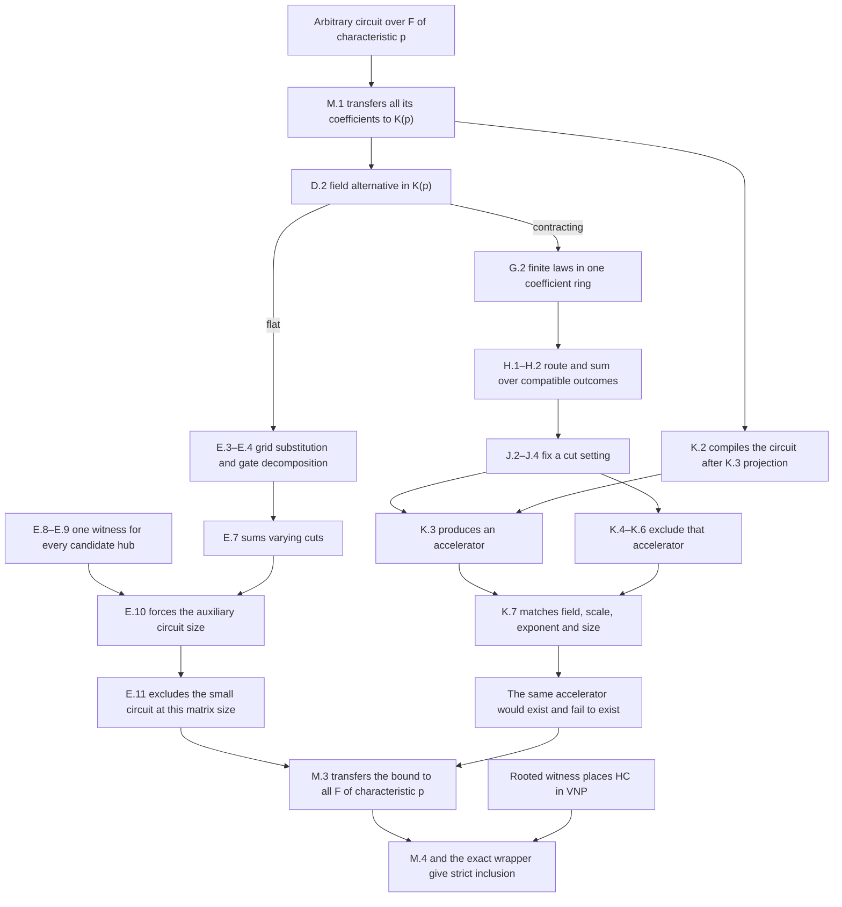

# Pass 14 synthesis · From a single candidate circuit to a contradiction

**Scope.** The original is the 70-page manuscript at publisher commit `11b6c7e3c927df2658f513b6b68ea7f8929c62c5`. The question concerns exact arithmetic circuits with arbitrary reuse, field constants, cancellation and nonuniform choice at each matrix size. Below, the branches are alternatives for the same comparison field. The choice of grid instance, program, or balanced cut can depend on that branch. Formal replay, mathematical reconstruction and checks on weakened assumptions each have their own receipts.

## 1. What can be held fixed?

Let p be zero or prime. Choose one small algebraically closed comparison field K of that characteristic, as M.3 does. A candidate for HC of size s over *any* field F of characteristic p gives a candidate of size at most s over K by M.1. The matrix variables remain formal. Only finitely many coefficients enter the candidate, and their common coefficient algebra can be specialized at once. For example, mapping two occurrences of the same coefficient to two unrelated elements would not define a ring map on the algebra that records the circuit relations. The common threshold for F comes from working over this choice of K, before receiving F. The property supplied by M.2 is grid completeness with dimension constant 40. The analogous permanent statement uses 3 and requires characteristic other than two. Substituting an affine matrix into a candidate pays at most five gates per original gate. The dimension and gate constants measure different operations. [M.1 transfer](11d-field-transfer.md) · [M.2 projection](12b-hamiltonian-projection.md) · [M.3 quantified proof, printed pp. 61–62](../primary/vp-vnp/Paper/Fields.lean#L80)

## 2. If K is flat

Choose k and ℓ so the E.3 grid fits inside the candidate matrix. E.4 turns the resulting arbitrary circuit into a sum over balanced cuts. It bounds the number of products for each fixed cut by the number L of gates of the grid circuit. There need not be any cut common to all products. E.7 evaluates this sum using a common spectral point whose existence comes from the finite Euclidean configuration of E.8–E.9. Take the auxiliary tensor-power limit for a fixed cut alphabet. Include the ends and both hubs for every candidate cut before selecting the spectral point. The paying cut may depend on that point. Its geometry has already been included in the same approximation. E.10’s published numerical consequence is log₂ L ≥ ℓk√k/16 for k≥2 and ℓ≥100√k. See the separate reconstruction for the stricter local constant and its hypotheses.

Set k=r², ℓ=100r as in E.11. The grid’s log size grows at most on the order of r³, while the lower bound for its log circuit size grows at least on the order of r⁴. Choosing r for *each* sufficiently large m handles intermediate sizes and absorbs the additive log₂ 5 from the affine substitution. The formal HC consumer obtains s>2^{(log₂ m)^{4/3}/1600²}. Thus a hypothetical s at or below this target is excluded in the flat case. [E.4 gate key](pass13A-gate-reuse.md) · [E.7–E.10 audit](14a-flat.md) · [Rate conversion](../primary/vp-vnp/Paper/Rate.lean#L337) · [HC caller](../primary/vp-vnp/Paper/Fields.lean#L51)

## 3. If K is contracting

**From laws to cuts.** G.2 first supplies a finitely generated subring A of K and a finite family of identities with controlled channel load. H.1–H.2 route packets on a particular tower, and preserve the value as a sum over admissible outcomes with shared edge data. J.2 regroups those outcomes into pieces. J.3–J.4 bound the size of each child by the target-scale allowance v^(H−32), preserve the parent weighted value on plain inputs and pay for constructing the lists. The child has a plain-time allowance v^H. These are absolute bounds at the chosen scale. The precise shared output is one setting (A, θ, h, C₀, v₀) with h≥17, finite generating names θ and a cutting hypothesis for H=16h. This existential is fixed before choosing circuit size, scale or program. [H.1–H.2 audit](14b-tower.md) · [J.3–J.4 audit](06-one-cut-and-iteration.md) · [Setting at the caller](../primary/vp-vnp/Paper/Cuts.lean#L570)

**Producing an accelerator with that setting.** Write lg n=⌊log₂ n⌋+1 for positive integers n. K.3 chooses B₀>0, C₁ and v₁ for H, the finite name support, and the projection factor κ. The field K is a nontrivial A-algebra. Suppose a circuit of size at most Mᵃ computes the target at a sufficiently large M and (lg M)^{Ca}≤M. The scale lemma, with E=(C₂+1)C₁ and a threshold at least v₁+v₂+4, supplies a single v satisfying

$$
v^{B_0}\le M,\qquad M^a\le v^{2B_0a},\qquad
(\lg v)^{E(2B_0a+1)}\le v .
$$

Let d=2B₀a and b=C₁(d+1). The same v satisfies K.3's scale condition (lg v)^{C₁d}≤v and K.6's (lg v)^{C₂b}≤v. The former produces HasAcc(θ,K,H,v,vᵇ). The latter rules out the identical proposition. Writing down b and v prevents applying a nonexistence statement at the wrong scale. K.2 receives a circuit for the exact projected clause polynomial. K.3 uses its global degree bound to sum the homogeneous components of that very polynomial. Only then does evaluation on the canonical word code of a short plain tree instance identify the result with its required weighted answer. Plainness qualifies the tree instance, and the word encoding supplies the polynomial evaluation point. The printed word sum and the projected polynomial can differ on other inputs. [K.2–K.3 audit](14c-compiler.md) · [Scale selection](../primary/vp-vnp/Paper/Scales.lean#L108) · [Matched applications](../primary/vp-vnp/Paper/Scales.lean#L141)

**Why K.6 has a contradiction to offer.** Transfer the finitely many program constants to the finitely generated A-subalgebra they generate. Then take a maximal quotient, a finite field E. The transfer preserves the accelerator and its bounds. On E, the functions c↦c^{2ʲ} run through a finite set of functions, so finitely many names for powers suffice for the diagonal. K.5 uses the cutting hypothesis and K.4's tally expansion to advance accelerators to scales large enough for that finite table. In the self-application P(P), one branch contributes 1, and the other reconstructs the weighted sum over tally exponents. First bound the size of each queried instance. The unconditional halting clause for bounded inputs supplies a run list and an accepting-run time bound. Each recorded bill has length below 2ᴶ, and every named weight agrees with the expanded trie. K.4 now produces the postponed instances with empty bills and a bound on their accepting costs. The formal budget fits this cost within vᴴ. This proves plainness, which *then* licenses the conditional equality of values. [Postponement](../primary/vp-vnp/Paper/Postpone.lean#L30) · [Budget and plainness](../primary/vp-vnp/Paper/NoAcc.lean#L181) With identical coefficients λᵉ in both expansions, the formal caller gets V=1+V. Subtract V in the nonzero finite field to obtain 0=1. If the coefficient ring were the zero ring, the last line would give no contradiction. This walkthrough reconstructs how the diagonal uses its contracts. [Pass 15](15-diagonal.md) gives the instruction, tally and scale budgets used here. [Finite field and bounded names](../primary/vp-vnp/Paper/NoAcc.lean#L23) · [K.5](../primary/vp-vnp/Paper/Next.lean#L178) · [Diagonal equality](../primary/vp-vnp/Paper/NoAcc.lean#L211) · [Assembling nonexistence](../primary/vp-vnp/Paper/NoAcc.lean#L353)

## 4. Putting the exponents and the family back

K.7 converts the discrete exponent denial into s>2^{c_K u²/log₂ u} for u=log₂ m and all sufficiently large m. The branch constant c_K is positive and may depend on K. Compared with the target u^{4/3}/1600², the exponent ratio is 1600² c_K u^{2/3}/log₂ u, which tends to infinity. Enlarge the threshold for this characteristic. D.2 supplies at least one of these branches. M.1 transfers the conclusion back to every F of that characteristic. Rewriting 2^{u^{4/3}/1600²} as m^{u^{1/3}/1600²} exhibits the universal coefficient. No uniform cutoff over all characteristics is needed. The characteristic-two exception applies to the permanent only. M.4 adds the rooted HC Boolean witness to give HC in VNP. If HC were in VP there would be one C with size ≤m^C+C for all m. Taking m large enough for m^{c(log₂ m)^{1/3}}≥m^C+C contradicts the strict bound. VP embeds in VNP by using zero auxiliary bits. [Rate comparison](../primary/vp-vnp/Paper/Fields.lean#L64) · [M.4 membership](pass13D-membership.md) · [Strict inclusion](../primary/vp-vnp/Paper/Fields.lean#L142) · [Released exact wrapper](../primary/vp-vnp/Solution.lean#L34)

**Evidence boundary.** The invariant and scale calculations above audit the composition of the paper's interfaces. The complete build and the challenge comparison address the encoded theorems, including the exact separation, with their named axioms. The printed/formal domain difference in K.3 is a counterexample to a stronger intermediate reading. Validation of the encoded conclusion and hand verification of every textual argument are separate entries in the coverage register. [Formal track](14d-formal.md) · [Claim register](../report/proof-coverage.csv)

## Dependency map for a single candidate

Follow one outgoing edge of D.2 in the same field. Each contradiction rules out that candidate under its own branch conditions. To pass from a lower bound to strict class inclusion one also needs HC membership.

The edge from K.3 to the contradiction includes the fixed finite name map, one nontrivial coefficient algebra and the *same* scale on both sides. The [PDF](../report/VP_VNP_Research_Review.pdf) gives the exponent substitutions implementing that edge. Each block can be located independently through the [claim-level register](../report/proof-coverage.csv).
